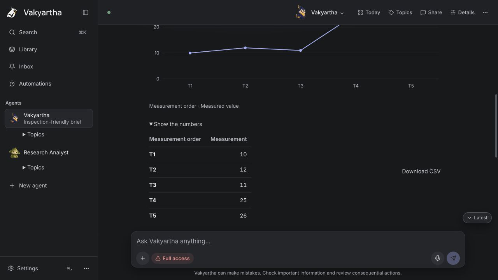

# Why installed answers still look like plain output

Status: historical. Investigation of the installed local service and desktop
on 2026-10-22, followed by a coordinated instruction/receipt correction.
Verification results are recorded below; no universal answer-quality claim.

## What actually happened

Installed `vak` reports `8.25.0 (f4867ff84)`. The gateway at port 8901 reports
build parity, workspace `/Users/nisheethranjan/vak-home`, and the configured
`openai-responses:gpt-6-luna` route. The original conversation is
`01a1631a-abbc-7ae3-aa53-a07cde89b3eb`.

Read its transcript, decisions, receipts, recorded interface and presentation
through the authenticated HTTP API. Inspected the running native desktop's
accessibility tree and screenshot. No raw ledger or credential files were read.

| Request | Accepted plan | Observed output |
|---|---|---|
| How did the markets close today? | One text outcome plus an evidence question | Plain refusal; no retrieval call. |
| Can you not search and get all data? | One text outcome | A sources card with two findings; no separate quantitative view. |
| Detailed end-of-day analyst report | One generic card outcome and three evidence questions | Summary, table, details, sources; all four are in the server projection and native accessibility tree. |

The final report's card fallbacks contain 118, 181, 250 and 282 whitespace
separated words respectively. This is an answer dominated by narrative and
source findings, not lost structured output. No stats or chart tool was called.
There was one refused table call: comma-grouped values and Unicode minus signs
were supplied to explicitly numeric columns. The retry removed `numeric_columns`
and was accepted with every column marked nonnumeric. That is a real loss of
numerical semantics while preserving a table's appearance.

Across the conversation there were 26 execute receipts and 26 provider attempts,
all settled `ok`; the evidence does not support blaming provider failure,
malformed card JSON or card-tool withdrawal. Source acquisition had separate
failures: no admitted discovery capability, confined Chrome launch failure,
ordinary fetch timeouts and a 403. Later known-source fetches succeeded. The
report itself disclosed inconsistent source fields; a confident chart of those
returns would have been misleading. Absence of a chart alone is not a defect.

## Instruction inventory and contradictions

The recorded last-turn interface contains the actual system prefix and tool
schemas. Stats, chart and the other native forms were offered. No capability
was excluded. The serving prompt API's editable-block provenance is entirely
the shipped seed; no local identity/rules/guardrail override explains the
behavior. The main Vakyartha Agent has empty additional instructions. The
Research Analyst is a separate Agent, with its own instructions, and did not
author these responses. No MCP server or enabled hook added an answer recipe.

| Instruction owner | Observed contract | Consequence |
|---|---|---|
| Shipped presentation block | Prose or cards; smallest complete answer; optional summary; no repeated findings | Form selection is delegated, but gives limited positive guidance about the work structure should do. |
| Web/desktop surface description | Reply rendered as Markdown | Describes only prose despite typed forms being available. |
| Loaded research skill | Mandatory summary then sources; optional comparison/table | Competes with general form choice and encourages long source findings to repeat the report. |
| Skill companion wrapper | “use them rather than another format or a script”; only `webfetch` listed | A domain-overlap hint sounds like an exclusive tool/format restriction, omitting available card tools. |
| Plan tool | Generic card or a named form; requested outcomes rather than every tool | A generic report can be marked delivered by its first named card. It provides no guarantee of coverage or useful composition. |
| Plan receipt checker | Keeps the named outcome, discards actual form | Even a specifically promised chart can be covered by a different card under the same name. Source-confirmed structural defect; the original report used a generic form, so this did not cause that particular selection. |
| Continuous answer renderer | Related forms inherit a borderless open surface | Correctly implements the recent approved optimization. Prose-heavy forms consequently look like prose; restoring boxes would not fix composition. |

The loaded research package is `everyday-starter` 1.2.0 and its bytes match the
source skill. Its `browse` instruction is stale: rendered retrieval is
`webfetch` with `render: true`. Reviewed the other shipped everyday, developer
and answer-layout procedures as product material, not instructions to this
investigation. Planning/writing/review procedures also dictate presentation;
the time-layout skill simultaneously prescribes every part and says the guide
is optional. These are shared instruction-ownership faults, not a market topic.

Reviewed prompt inheritance/resolution, code-owned contracts, surface guidance,
tool inventory/schema generation, skill companions, plan normalization,
completion/correction feedback, context-tail assembly and historical admission.
The public interface exposes the latest recorded prefix; it is not a complete
capture of every provider request's temporal tail. No claim that every historical
request was reconstructed byte for byte is made.

## Why more card commits did not settle this

Earlier work addressed different boundaries: malformed nested arguments,
per-form tools, transport projections, order/placement, Canvas behavior and
visual enclosure. Those fixes can be necessary and pass their own checks while
the main model still receives incompatible presentation guidance. The latest
display optimization deliberately changes enclosure, not which information
the model chooses to emit. A gallery supplies already-authored payloads, so
it cannot test that choice. The old plan check could certify a named receipt
without preserving its form. Neither layer established a useful complete
answer from a natural request. The original conversation now shows accepted
forms reaching the desktop, so replaying the old malformed-JSON diagnosis
would miss the current failure.

The corrective unit is the whole instruction-to-plan-to-receipt-to-visible
answer path, exercised by varied real requests. Changing just one prompt line,
restoring card boxes or declaring success from a renderer fixture would leave
the other contradictions intact.

## Independent design judgment and frozen baseline

The maintainer requested Luna judgment through the local home. Created a separate
consultation session `01a16328-4a9f-78c0-b6f4-6ed97494ee38` on the installed route,
supplied the observed contracts and constraints, and asked for criticism without
files, external retrieval or changes. Luna recommended the separation in
[the implementation plan](../plans/answer-design-contract-plan.md), while warning
that typed receipts and instruction alignment do not guarantee semantic quality.
This is advisory review of supplied evidence, not an independent code audit.

Before product edits, fixed seven subject-independent requests on that same
provider in a disposable workspace, using the installed binary on port 8937
without gateway mode. Read results and accepted tool calls through its API.

| Scenario | Installed baseline |
|---|---|
| Direct arithmetic | Plain `56`; appropriate. |
| Exact literal sentence | Exact sentence; no added card or narration. |
| Supplied records and extrema | Table. |
| Measured ordered series and largest jump | Table and stats; one numeric missing-value refusal. |
| Supplied options with incompatible constraints | Comparison plus prose repeating its findings. |
| Supplied dated milestones | Steps. |
| Conflicting supplied measurements | Prose preserving both accounts and uncertainty. |

An initial admission 429 prevented the last two sessions from being created;
completed them afterward without rerunning the successful cases. This was local
admission pacing, not a provider failure. These results refute a blanket claim
that the current build never uses cards. They do not prove that every prose
answer should become a card or that every measured series needs a chart.

## Correction and verification

The [plan](../plans/answer-design-contract-plan.md) defines one coordinated batch:
one presentation authority, procedure-focused skills, nonexclusive tool hints,
truthful rich-surface descriptions and actual active typed receipts in both
the loop and settled evaluation. It preserves the recently approved display
optimization. No domain router, keyword classifier, fixed card count, automatic
permission widening, nested answer tool or per-turn secondary reviewer is added.

The coordinated correction is implemented in one working-tree batch. It changes
the prompt, rich surface wording, related-tool wrapper, procedure skills, numeric
table guidance, and typed active receipt checks. Shipped packages have patch
versions; the test workspace installed them through the normal immutable plugin
store. The installed owner's cached packages were not patched by hand.

Final source verification:

- `vak-agent` library: 118 tests pass; `vak-judge` library: 39 pass.
- `vak-core` library: 562 pass, one existing test ignored.
- Agent required-card integration tests: 15 pass, including a supporting form
  that says `done` while the promised form is still missing.
- Changed-crate Clippy with all targets and warnings denied passes. The dev
  CLI and tool-worker build succeeds; the linker reports its large unwind-table
  warning. No full workspace gate, commit, release or installation is claimed.
- Formatter, record, documentation-path and version checks pass.

The first core run found two assertions tied to the old presentation wording;
they were updated to the new shared contract, then the full library run passed.
Clippy found an unnecessary clone in a new test; that was corrected and the
check rerun. The final product source was frozen through final verification.

The [frozen prompts](fixtures/answer-design-scenarios-2026-10-22.json) were run
again on the final candidate and the same configured provider, without asking
for particular card tools. [Results and session references](fixtures/answer-design-results-2026-10-22.json):

| Scenario | Final candidate |
|---|---|
| Direct arithmetic | Visible `56`, no cards. |
| Exact literal sentence | Exactly one visible sentence, no cards. Runtime-control replies in the transcript are not additional displayed answers. |
| Supplied records | Typed table; all four original values retained and quantity remains numeric. |
| Measured series | Chart of all five exact values, table of changes, largest-jump callout. |
| Options | One comparison, no duplicated closing prose; neither option misrepresented as satisfying both constraints. |
| Dated milestones | Calendar with all four dates and labels preserved. |
| Conflicting measurements | Summary, typed table and details; both accounts retained, comparison limits and unresolved disagreement explicit. |

All seven final runs had zero tool-result errors. An intermediate candidate
put source metadata in a numeric cell and recovered without dropping the numeric
declaration; it also wrote a table in Markdown. The final shared contract makes
using the form's tool explicit, preserving its typed values and interactions.
These are observations of a small fixed corpus, not a universal success rate;
some summary/detail facts still overlap. No topic-specific rule was added.

A supplemental run explicitly loaded the revised research skill. Its actual
tool result contains the updated procedure and nonexclusive related-tool
wrapper, and it produced a table and details without the old compulsory
summary/sources sequence. A separate two-turn file test created `checklist.md`,
then checked its first item without changing the other text. The Library API
reports one item, two versions, with Version 2 parented to Version 1.

Inspected the final chart in the running browser, expanded **Show the numbers**
and checked the five original values, and observed no document-width overflow
at the default 1280 × 720 viewport. This is a final-output interaction check,
not a claim of four-way theme/phone or fresh native WebKit qualification.
No client source, CSS or bundle was changed; the recent Continuous answer,
compact file collections and their surrounding display optimizations remain.

## Remaining boundary

The supplied-only scenarios can still receive a generic **Partial result**:
their outcome includes the inferred `evidence-1` requirement with no external
retrieval receipt. The file test also carries conservative evidence notices.
This is an evidence-requirement/sufficiency issue, not a missing form. It was
not hidden, converted into success or repaired with a subject-specific rule.
It needs a separate design of supplied evidence versus retrieved evidence.

Instruction alignment and typed receipts cannot prove relevance, eliminate all
semantic repetition or choose the best presentation for arbitrary future work.
Larger workloads, alternate routes, creative output and interactive-artifact
revision remain broader acceptance. The implementation fixes concrete contract
faults and demonstrates useful selection on these requests; it does not certify
every possible answer. The original installed gateway remains on its release.
