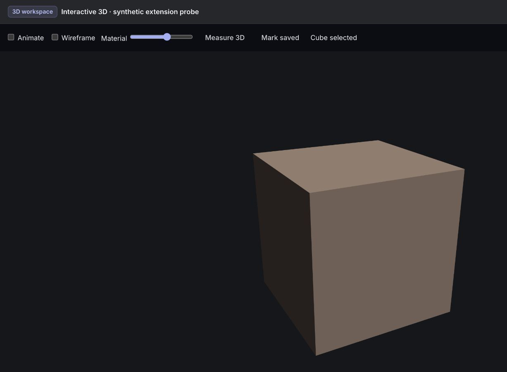
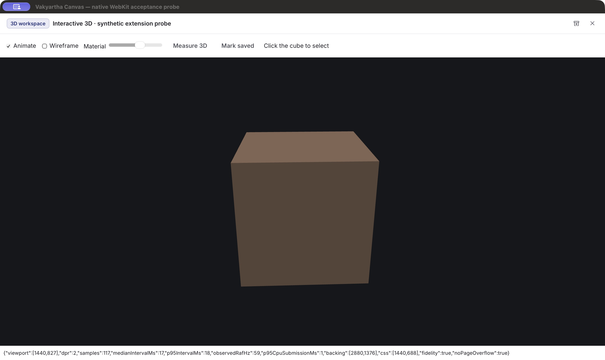
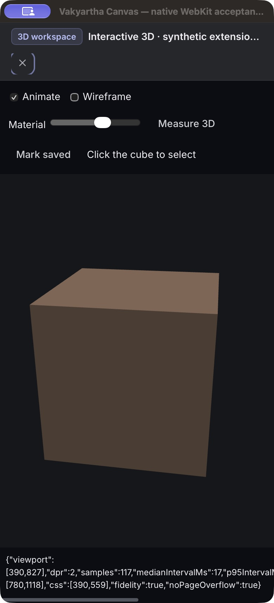

# Shared Canvas foundation acceptance — 2026-10-22

Status: **historical — implementation and bounded acceptance evidence; installable extensions and full hardware/shell qualification remain open.**

## Main agenda and implemented scope

One common Canvas for browser and desktop, capable of hosting a complete domain
workspace while preserving the small core. The [research](../research/canvas-workspaces-2026-10-22.md)
records the primary-source survey and our design. The original
[architecture review](canvas-workspace-architecture-2026-10-22.md) remains the
dated defect record; C1/C2 are repaired by the current changes.

- Current-contract restoration refuses the whole snapshot on an unknown subject,
  invalid identity, duplicate key, invalid checkpoint or active tab. No tab is
  silently dropped. A valid namespaced workspace with an absent contribution
  has an unavailable view and retains its subject and checkpoints.
- Inline previews use WebCrypto SHA-256 of markup/library content with canonical
  session/base-resource scope. Display title is not resource identity. Answer
  subsets use canonical sorted identifiers instead of an ambiguous short hash.
- Shared compiled renderer registration and checkpoint/viewport services work
  through the existing frame. Checkpoints survive remount, protect eviction,
  require explicit discard on close, and participate in CAS/recovery conflicts.
  Reopening a remotely closed tab replays its editor state as well as subject.
- Mail/calendar editors checkpoint their inputs when hosted in Canvas. Domain
  save clears pending edits only if no newer input arrived during the save.
- Tabs support arrows/Home/End/Delete. The split divider supports captured pointer
  drags, arrow keys and reset. Narrow mode uses the focused geometry; focused
  Canvas contains keyboard focus while split mode permits conversation access.
- Shared sizing separates CSS and physical pixels, handles fractional DPI and
  coalesces resize. Drawing scheduling stops hidden/offscreen/disposed or
  context-lost work and permits either on-demand or display-paced animation.
- The plaintext Canvas conversion path is removed. Current Document schema is
  required; no migration reader, new storage system or package dependency added.

## Automated evidence

All 42 client Node test files pass, including eight Canvas files. New cases cover
colliding old markup, resource scoping, answer identifier delimiters, checkpoint
serialization/eviction, concurrent choices, remotely closed-tab recovery and
physical backing sizes at DPR 1, 1.25, 1.5, 2 and 3. Additional tests cover
independent note/domain edits, copied checkpoint values and disposed editing
leases. A deterministic scheduler test covers idle drawing, coalescing,
visibility/offscreen resume, context-loss signals, DPI changes, cleanup and
draw-error containment; it is not real GPU context-loss evidence. Production and Canvas fixture
TypeScript checks pass. Both shared client bundles build. Server Canvas tests
pass (five): current schema only, invalid-write refusal, conversation ciphertext,
one-winner concurrency and opaque-field CAS preservation. Linker emits the
existing large unwind-table warning in this debug test build.

## Browser rendering and interaction evidence

`tests/canvas-drawing.html?run` exercises the production frame with a synthetic
2D viewer. Desktop 1440×900 DPR2 and phone 390×844 DPR3, light and dark, all pass:
checkpoint remount, dirty close/keep working, keyboard tabs, resizing, no page
horizontal overflow and correct physical backing pixels. Each samples 120
requestAnimationFrame intervals. Median ~8.3 ms (~120 callbacks/s); p95 ~9.2–9.3
ms, CPU paint p95 ~0.2 ms. Synthetic input-to-draw p95 ~16.9–17.7 ms. This is
script-dispatched input to drawing, not trusted hardware input or INP.

`tests/canvas-3d.html?run` registers a generic workspace and renders actual
WebGL2 solid triangles with perspective, normals, lighting and depth. It includes
wireframe, animation, orbit, wheel zoom, ray picking and material checkpoints.
The same four viewport/theme cases pass physical sizing/no-overflow. Median
~8.3 ms (~120 callbacks/s), p95 ~8.9–9.2 ms, CPU submission p95 ~0.1 ms for the
small scene. Stopping animation and clicking the scene visibly selects the cube.
The source is only in the acceptance fixture; no production scientific engine
or end-user plugin is implied.

The existing document-viewer fixture also passes its 39 desktop checks and
38 narrow-layout checks in both phone themes, with no horizontal page overflow: scoped
file routes, origin disposal, selection/comments, version notices, tab and
conversation restoration, focused/split choice and viewer error containment.

[Raw browser results](../assets/canvas-foundation-2026/browser-results.json)
record the matrix. These are same-machine emulated layouts, not physical phones.
Frame callback intervals are not verified display presentation or GPU completion;
CPU draw/submission timing is not a GPU benchmark. Short runs do not establish
large-scene throughput, thermal behavior, long-session memory or solver speed.

## Native WebKit engine probe

A temporary Cocoa application with WKWebView loads the same localhost shared
fixture. It has no Tauri IPC and no production accounts or data. Actual measured
viewport is 1440×827 (the OS clamps the requested 900-pixel content height) and
390×827 at DPR2. Desktop light and phone dark report correct backing pixels,
no page overflow and solid WebGL2 rendering. Desktop median 17 ms, p95 18–19 ms;
phone median 17 ms, p95 19 ms; ~59 callbacks/s, CPU submission p95 1 ms.
This engine result differs from Chromium's ~120 and is recorded, not hidden
behind a fixed-rate claim. The host schedules at the engine/display cadence.

This proves actual WKWebView rendering on this Mac, not installed Vakyartha
Tauri-shell behavior, native resource adapter parity or other OS WebViews.

## Remaining gates

Installable contribution manifest/activation/revocation and executable isolation;
typed resource, selection/context, command and undo services; complete domain
workspace; physical touch/pen and accessibility acceptance; installed Tauri,
Windows/Linux and mobile engine qualification; context-loss/restoration,
background/resume, reduced-motion, heavy-scene/memory and hardware latency runs.
No blanket “smooth across all devices” claim is warranted by this matrix.

## Fresh-session follow-through

Server Clippy passes with warnings denied. The standalone mail/calendar fixture
passes 51 checks at phone width. The shared editing boundary now copies values,
rejects cyclic/accessor/non-JSON or excessively deep graphs, and revokes leases
on tab disposal and compiled contribution removal/replacement. Concurrent
discussion notes and domain checkpoints merge independently.

`tests/canvas-host.html?run` adds 15 full-frame lifecycle checks for focused entry,
contribution removal/return, pending work, late callbacks, explicit close and
focus restoration and the same resource in two conversations. It typechecks, but has not been run in the browser: local
browser control was disabled in Work settings in the fresh session. Existing
viewport/rendering evidence above predates these final lifetime changes. The
new fixture and renderer-replacement integration require browser qualification;
Node editing-lease tests do pass. No security setting was bypassed.

Mounted viewer identity now includes conversation and subject, with scoped/
revoked selection and registration callbacks. The new fixture also checks
conversation-specific leases and pending edits; UI qualification remains open.
