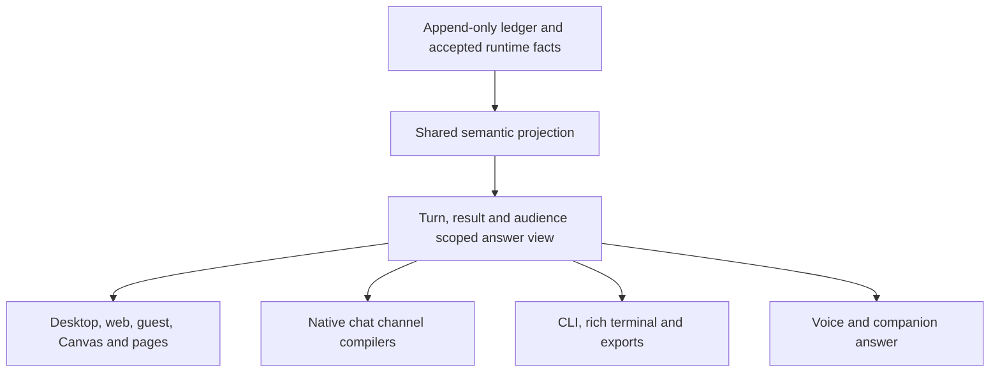

# Response projection across surfaces — 2026-10-23

Status: historical — review of source at `e6934a00e`, the projection history
and recorded acceptance. Recommendations below are not an approved new
architecture or an implementation claim. No installed service or user data
was changed. Current focused client checks passed; other findings are source
and call-graph evidence, not fresh live reproductions.

## Conclusion

The recurring work has a structural cause: several consumers independently
construct what they call the response. Shared owner chat preserves an ordered
timeline; channels reconstruct cards plus final text; saved-page text reconstructs
another combination; terminals and exports consume different inputs. Local fixes
can therefore pass while another supported surface still loses content or state.

The repository already has the necessary vocabulary in
[`OutputTimeline`, `OutputItem` and `PresentationDocument`](../../crates/vak-delivery/src/presentation.rs).
Consolidate their use. Define one turn/result/audience-scoped answer view over
those types, with shared visibility, identity, source order and outcome rules.
Every surface should render that view according to its capabilities. A whole
timeline also contains user messages, approvals, retries and progress; passing
it wholesale is not a substitute for defining this selection once.

Keep the current authoring direction: Markdown, five optional precise rich
tools, mechanical runtime sources/diffs, no model-authored layout. This does
not require another model-facing answer envelope, durable answer store,
planning tool, topic classifier or card vocabulary redesign.

## Why this has felt almost daily

A path-scoped history count found **300 non-merge commits on 54 dates from
25 August through 23 October**, including **55 commits on 14–23 October**.
These include new features, refactors, releases and formatting; they are not
300 fixes, nor a count of every presentation-related change.

Reproduce the population, then count rows and distinct date fields:

```sh
git log --since=2026-08-23 --until=2026-10-24 --no-merges \
  --date=short --format='%h %ad %s' -- \
  crates/vak-server/src/projection.rs crates/vak-server/src/projection \
  crates/vak-server/src/client_events.rs crates/vak-delivery \
  crates/vak-presentation \
  crates/vak-client-ui/src/components/PresentationRenderer.tsx
```

There are three kinds of work in that history:

- **Changes of direction:** semantic envelopes and signal/recipe selection,
  topic-labelled cards, recorded card calls, portable flat arguments,
  model-authored outlines, and finally Markdown plus runtime composition.
  Representative commits are `63be08231`, `81d17cd5d`, `823941920`,
  `cb38239ea`, `3abc37045`, `9d09f9c24`, `acaa6734d` and `9037a9c4d`.
  The current direction is recorded in [the decisions](../decisions.md) and
  [the redesign acceptance](card-redesign-2026-10-22.md). Earlier plan-based
  audits explain history, not today's authoring contract.
- **Recurring correctness repairs:** substantive prose suppression, truncated
  card reconstruction, source order, replacement addresses, live settlement
  races and hydration. These recur where visibility and identity are decided
  independently. The [18 October review](architecture-and-presentation-review-2026-10-18.md)
  already identified this class of problem.
- **Acceptance gaps:** individual form galleries and packet checks passed
  without establishing a complete natural-request answer on actual consumers.
  The [installed channel audit](channel-card-rendering-2026-10-22.md) found
  old payload fixtures missing actual summary/sources failures. The newer
  [native channel implementation](native-channel-cards-2026-10-22.md) addresses
  form rendering, but real channel-client qualification remains open.

The [22 October answer-design investigation](answer-design-contract-2026-10-22.md)
also established a separate issue: correctly accepted cards reached the native
client, while conflicting instructions and repetitive content made the answer
poor. Projection fidelity and semantic usefulness need separate acceptance.
Successful card calls do not establish a useful answer; an unattractive answer
does not establish that its cards were lost.

## Current source findings

### R1 — channel and text consumers reconstruct an incomplete ordered answer

The server's `prose_and_distinct_cards_keep_their_projected_source_order`
test at `projection.rs:5728` expects prose/card/prose/card/prose. Gateway
settlement instead extracts `run_cards` and `channel_answer` separately
(`gateway.rs:3803`), using only the terminal `TurnOutcome` response text
(`gateway.rs:3904`). Earlier and interstitial visible assistant text is not
part of that response argument. The channel compiler then explicitly sends
all cards before all text (`vak-delivery/src/channel/mod.rs:103–117`).

This also conflicts with the current runtime sources/diff contract: derived
cards are recorded after the answer (`vak-agent/src/lib.rs:3900`, and
`projection.rs:1757`), but channel compilation moves them ahead of the prose.
This is a current-contract problem even without historical card tools.

`text_with_run_cards` (`projection.rs:230`) similarly combines all card text
with externally supplied narration. It is used by heartbeat, automations and
`last_assistant_text`. Fixing the browser row composer alone cannot repair
these paths.

### R2 — channel extraction detaches result state and identity

The canonical snapshot applies `ResultOutcome` to card-only answers as well
as prose (`projection.rs:107`). `channel_answer` reads metadata only from an
assistant Document (`:365`); `run_cards` returns only `StructuredOutput`
payloads (`:393`). `render_response` builds a new Markdown draft
(`delivery.rs:607`), and `attach_structured_cards`
(`vak-delivery/src/lib.rs:615`) synthesizes card identities, default placement,
no card state, no original provenance and `Succeeded` with no outcome.

A card-only partial, stale or review-required answer can consequently lose
its typed verdict during channel handoff. Merely calling the rebuilt packet's
timeline canonical does not restore the discarded information. Provider
message IDs may differ, but the internal source/result identities must survive
through compilation.

### R3 — saved-page items and saved-page text disagree

`answer_page` (`projection.rs:281`) keeps the full turn as `Page.items`, but
its text branch selects only the last assistant document and prepends every
card's text (`:301–320`). `Page.text` is explicitly the input for search,
export and readers without cards (`vak-delivery/src/page.rs:20`). The rich
page can therefore remain complete while its searchable/readable fallback
loses earlier prose and changes order.

### R4 — terminal consumers do not implement the presentation contract

The CLI prints raw `TextDelta` (`vak/src/main.rs:1655`) and ignores
`CardRecorded` through its wildcard arm (`:1803`). It does not replay a final
canonical answer to recover the omitted rich content. Tool progress lines
are not a readable projection of a card's deliverable.

`vak term` reduces presentation items to id/kind/title/status
(`vak-terminal/src/app.rs:127`, `:439–523`), discarding `content` and
`fallback_text`. `OutputItem` has no title field. The Studio document pane
looks for `text`, `markdown` or `document` kinds (`ui/studio.rs:95`), while
the current kind enum uses `message`, `card`, `outcome` and other activity
kinds. It also ignores text-delta and completion presentation operations.
No alternative answer-body consumer was found in its agent-event handler.

### R5 — visibility and turn identity still have multiple authorities

Settled presentation rejects the last assistant entry containing text when a
typed correction discards it (`projection.rs:1132`). Transcript projection
rejects only an immediately adjacent text-only assistant
(`vak-server/src/lib.rs:8547`). `client_events` projects `DraftDiscarded`
(`:260`); `projection::live_event` falls through its wildcard for it
(`projection.rs:2713`). These paths can disagree until settlement.

`conversation_history::canonical_turns` maps positional turn labels onto stable
directive IDs (`conversation_history.rs:259`). The live/history wrapper uses
it, while `/presentation` and `/results` separately call raw snapshot
constructors (`lib.rs:7982`, `:8055`). Identity should be established inside
the shared projection boundary, not repaired by selected endpoints.

### R6 — guest, export and voice paths require explicit conformance

The guest conversation reads transcript text and cards separately
(`SharedConversation.tsx:154–163`), draws prose as plain paragraphs, and then
draws all cards in a separate Results section (`:404–412`). Sharing individual
card renderers does not share response composition or outcome treatment.

CLI export uses `derive_conversation` (`vak/src/main.rs:61`); server export
uses `conversation_messages`, which also excludes rejected drafts
(`vak-server/src/lib.rs:8693`). A shared Markdown formatter cannot make
different visibility inputs equivalent. HTML export has a separate line
parser (`vak-presentation/src/transcoder.rs:239`) rather than the production
document tree.

Voice receives `ChatReply.text` (`vak-server/src/voice.rs:1285`). A voice
adapter may intentionally narrate prose and direct a person to companion
visuals; it needs an explicit capability contract and result-state treatment.
Identical spoken words or reading every table cell aloud is not the goal.

## The consolidation to make



This refines S3 of the existing
[architecture and presentation hardening plan](../plans/architecture-and-presentation-hardening-plan.md).
It is a recommendation, not a newly approved rewrite.

1. **Establish the failing corpus first.** Use recorded or production-shaped
   typed entries, with independently specified expected content, identities
   and verdicts. Include prose before/between/after rich blocks, runtime
   sources/diffs, card-only partial/review results, multiple results, discarded
   drafts, aborts, replacements, reconnect, history paging and next-turn races.
2. **Centralize selection and semantic reduction.** Reuse existing types in
   a module accessible to Core, server and CLI. Share typed visibility,
   replacement and item-construction rules between replay and accepted live
   updates. Keep live text provisional and preserve the existing authoritative
   settlement/`covered_sequence` boundary. Do not rebuild the whole history
   or parse every Markdown prefix on each token.
3. **Carry ordered items through consumers.** Replace the split final-text /
   card-payload handoff. Preserve outcomes and provenance. Derive page text,
   plain output and export from the same selected order. Use the shared web
   composition for guests with their existing audience and action restrictions.
   Repair the actual CLI and rich-terminal consumers.
4. **Make capability loss explicit.** Retain the current typed form and native
   channel compiler work. Channel limits affect continuation and geometry;
   unsupported interactions become declared static content or a companion link.
   Existing coverage/fallback/limitations concepts should account for every
   selected item without duplication or silent disappearance. Permission and
   grant enforcement remain separate and must not be widened by rendering.
5. **Gate the complete path.** Compare live convergence, settled/reloaded
   history, saved-page text and actual surface adapters against the corpus.
   Add deterministic adapter/client checks to the gate; reserve real native
   browser/channel acceptance for the representation each actually draws.
   Keep semantic answer-quality scenarios as a separate acceptance track.

Completion means each supported surface preserves its declared answer
contract across those states. A form gallery, a successful build, a large
scenario count or a correct owner-chat screenshot establishes only its own
boundary. Surface-specific geometry will continue to evolve; shared meaning
and visibility should no longer be rediscovered in each renderer.

## Checks and limits of this review

- Initially clean working tree; baseline `e6934a00e`, workspace version
  `8.31.0`. Runtime/product code remains unchanged.
- `node --experimental-strip-types crates/vak-client-ui/tests/answer-composition.mjs`
  passed: source order, boundaries, file consolidation and stable anchors.
- `node --experimental-strip-types crates/vak-client-ui/tests/presentation-hydration.mjs`
  passed: deltas, addressed replacement and late-event protection.
- `scripts/gate.sh` runs Rust and repository checks, but does not execute
  these Node tests or the real browser fixtures. Its success does not imply
  their coverage.
- Record/index, documentation-path, version and whitespace checks passed.
  Blueprint views were regenerated with F7 and no needs-review findings.
  A second source review supported the findings and scoped recommendation.
- No Rust suite, live model corpus, installed native UI, outbound channel
  message or fresh voice acceptance was run for this review. Concrete runtime
  symptoms above are source-supported consequences, not new production
  incident claims.
