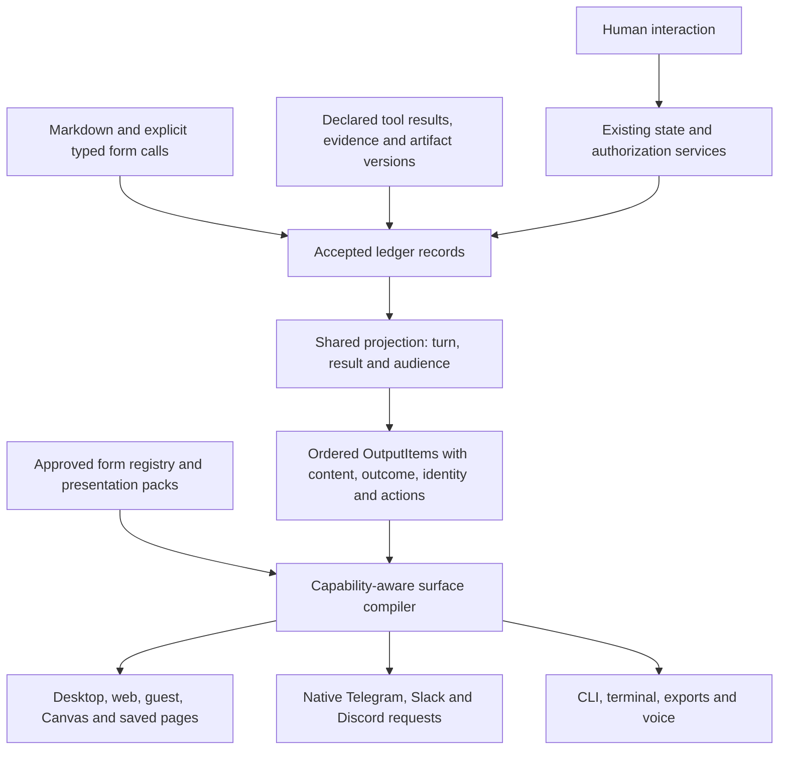

# 104 — Rich response contract

Status: in progress (23 October 2026) — implementation authorized by the
maintainer, including clean replacement without legacy compatibility. Shared
ordered answer selection, channel handoff, replay draft exclusion, saved-page
text, terminal, exports, voice companion and shared rendering are implemented
and released locally; the full repository gate and local browser acceptance
pass. Slack native charts
are qualified structurally. R3–R5 state/action and native acceptance exits below
remain open; no external agent UI implementation is adopted.

Research: [current primary sources](../research/rich-responses-2026-10-23.md).
Repository evidence: [response projection review](../audits/response-projection-across-surfaces-2026-10-23.md).
Implementation: [consolidation and local acceptance](../audits/rich-response-consolidation-2026-10-23.md).
Implementation work belongs to S3 and the applicable surface stages of
[the existing hardening plan](../plans/architecture-and-presentation-hardening-plan.md),
with status in [the one tracker](../plans/open-items.md).

## 1. Product outcome

An answer may combine readable prose, rich cards, data views, controls, media,
sources and files. A person can use supported interactions, revisit the answer,
open it in Canvas, save it, share it within its audience and receive it through
a channel without losing what it means or whether it is complete.

**Rich content is first-class accepted answer material.** Markdown is one
authoring syntax for document parts and one readable fallback. It is not a
replacement for charts, semantic comparisons, bound controls or typed actions.
A card is an information shape; its visual enclosure is a host decision.
This preserves the approved Continuous answer treatment rather than requiring
a box around every paragraph.

The architecture is not defined by how many card tools are currently offered.
Its stable boundary is accepted semantic content, followed by rendering for
each surface. An ordinary short answer may remain a sentence. A rich answer
must be useful without repeating the same findings in every view.

## 2. Research judgment

Current A2UI and json-render show the value of constrained component catalogs,
bound data and native host rendering. AG-UI addresses ordered interaction and
state streams. Adaptive Cards demonstrates feature/fallback negotiation.
ChatKit offers typed widgets/actions, while MCP Apps addresses isolated HTML
application embedding. Native channels now have capabilities beyond basic
Markdown and embeds. The dated research records versions, sources and limits.

The recommendation is to apply these separations in Vakyartha's own contracts.
No reviewed standard supplies all of its durable identity, outcome, audience,
ledger, erasure and effect requirements. The repository rule that Vakyartha
owns its UI schemas, compiler, renderer, state, actions and event contract stays
in force. Third-party UI SDKs, runtimes and protocol bridges remain excluded.
Future interoperability is a separate governed design decision.

## 3. Three contracts, one accepted answer

### Accepted content

Reuse `OutputTimeline`, `OutputItem`, `PresentationDocument`,
`StructuredOutput`, `ResultOutcome` and artifact/version references in
[`vak-delivery`](../../crates/vak-delivery/src/presentation.rs).
A whole timeline contains requests and activity too. Expose one shared
turn/result/audience selection over it; an answer can contain independently
evaluated results. This selection is a derived view, not a second durable
answer ledger, a model-authored outline or another product entity.

Retain each item's source order, stable identity, role, result outcome,
provenance, accepted relations, artifact version, interaction state and
readable fallback together. A surface must not reconstruct an answer from
only its final prose or a list of extracted card payloads. A delivery-job or
provider-message ID is a mapping to original item identities, never their
replacement.

### View description

Existing forms and approved packs describe how accepted data can be shown.
The host controls components, design tokens, accessibility and geometry.
Data bindings reference accepted values and exact artifact versions. A view
cannot mint new evidence, promote a result to success or authorize an action.

Keep data, presentation and state lifetimes distinct. A new data observation
does not silently rewrite a recorded answer. A locally adjusted
control can recompute a viewer's result without claiming that an external
provider returned it. An explicit refresh that fetches data opens admitted
work and produces new accepted ledger records. Updating an existing versioned
artifact also creates its next artifact version with its actual parent; an
ordinary answer does not gain a separate versioned identity.

### Surface plan

The target compiler consumes the selected ordered items plus its capability
profile and produces a transient render/request plan. Desktop/web can retain
the full native contract; channels use their own native vocabulary. Plain,
voice and export projections use the same selected content and result state.

The plan names what each item becomes: native representation, equivalent
static content, readable fallback or an authorized companion view with an
explicit limitation. Missing critical content or result state is a failed
compilation, not a successful empty rendering. Provider continuation may
split an item but must retain its source mapping and sequence.

## 4. Authoring rich answers

Use two explicit inputs to the same accepted representation:

- **Document syntax:** Markdown is parsed into typed paragraphs, headings,
  lists, tables, quotes, code and supported diagrams. These use real host
  document renderers; they are not one opaque transcript paragraph.
- **Semantic forms:** precise form builders carry data or interaction that
  document syntax does not express adequately: chart scales, quantity
  semantics, map connections, calendar placement, bound controls and typed
  choices. Explicitly selected forms keep their validated payloads as cards.

The main model chooses what to say and which admitted form adds value. The
runtime owns layout and surface compilation. Do not infer summary, chart,
comparison or pack choice by reading a topic, prose words or item count.
Do not rebuild a mandatory plan, whole-answer JSON argument, union card tool
or second per-turn presentation model call. Preserve precise flat schemas,
wire-enforced structure where supported, and the common repair contract.

**Decisive implementation default:** retain the currently offered chart,
stats, map, calendar and controls tools during projection consolidation.
All retained forms remain first-class drawable content, including history,
explicit existing fences and runtime records. This is a starting authoring
policy, not a five-form ceiling on the answer or the architecture.

Do not reopen every model-facing form at once. A form becomes an additional
authoring capability when a production-shaped case requires semantics or
interaction that the document AST, admitted tools and runtime records cannot
carry. A comparison with recorded choices is a plausible candidate; a new
shell for a paragraph is not enough evidence. The same natural-request corpus
must establish completeness, absence of unnecessary repetition, reliable
selection, context/schema cost and surface fidelity before that admission
change is approved. Discovery/loading changes are explicit capability work;
the current code always loads presentation schemas, so on-demand card
schemas must not be described as already available.

Tool adapters may declare typed presentation data from their actual results.
No generic key-sniffing turns arbitrary provider JSON into a supposed form.
Runtime records own actual retrieval receipts, changed-file hunks, tests,
commands and artifact attachments. Model-authored explanations and citations
cannot fabricate successful execution or evidence.

## 5. One form definition, several renderers

Consolidate the existing form registry into an authoritative descriptor for
each information shape, in the existing presentation/delivery layers. A
descriptor identifies its argument schema when offered, accepted payload
schema, builder/validator, supported interactions, accessibility contract and
text/data fallback. Argument and stored-payload schemas have different jobs;
do not force them into one lossy shape.

Generate or mechanically check TypeScript bindings, registry membership and
production conformance fixtures from that contract. The current checks that
names agree are necessary but insufficient: actual payloads, values and
actions must agree. Renderers remain small host-owned implementations.

A form's descriptor records expected representation for every supported
surface: native, static, fallback or companion. A new form cannot be declared
complete while a surface silently omits it. Packs may bind existing forms
and data using the existing activation/revocation rules. A new domain or
visual skin does not require a new core primitive or topic router.

Preserve decimal spelling, source scalar types, missing values, units,
coordinates, dates/time zones, chart spacing/gaps and source links. The
existing scalar/chart fidelity rules in
[the renderer guide](67-presentation-renderer-guide.md) remain part of the
contract. Formatting is not permission to reinterpret data.

## 6. Richness must survive target selection

Expand the current coarse surface-capability description with explicit
feature/version knowledge: supported forms and variants, data limits,
interactions, media/file rules, streaming, update lifetimes and accessible
equivalents. Use published adapter knowledge and qualified account/client
features, not a provider name as proof that every feature works.

**Do not lower a chart or map before choosing the target.** The current
[`channel/forms.rs`](../../crates/vak-delivery/src/channel/forms.rs) destroys
those distinctions too early. Preserve typed forms through provider selection;
the target compiler decides whether its native component is equivalent.

| Surface | Required direction |
|---|---|
| Desktop/web | Native rich forms, typed documents, data bindings and actions; responsive reading widths and existing theme/accessibility rules |
| Guest conversation | Shared ordered composition after server audience filtering; allowed actions differ, content is not independently rebuilt |
| Canvas and saved pages | Same accepted items and exact captured resources; existing viewer-local behavior; text/search derived in the same order |
| Slack | Native chart/data-table/container capabilities where qualified, rich text and complete accessible equivalents; preserve a rich form until the compiler chooses |
| Telegram | Native rich blocks, disclosure, supported maps/media/buttons; routes/areas get an honest equivalent or companion rather than a falsely identical map |
| Discord | Deliberately selected Components V2 target for richer composition; honor its message-mode constraints. Existing embeds remain the implemented target until qualified replacement |
| CLI and rich terminal | Consume typed answer items and incremental operations; complete readable card/data fallback, outcomes and file links |
| Export | Shared visibility and selection; render the document AST and card equivalents, not another Markdown dialect/parser |
| Voice | Spoken prose and material result/limitation state with an accessible companion for visual data; a declared projection rather than silent omission |

Exact provider limits belong in adapters with source/date and boundary tests,
not duplicated in this long-lived contract. No provider documentation alone
establishes installed-client parity. Compile and validate the whole request
plan before dispatch. A provider refusal does not authorize a second send in
another format; the existing effects service remains the sole outbound owner
and preserves unknown outcomes.

## 7. Streaming and replay

Share semantic selection, construction, replacement and visibility rules
between replay and incremental accepted changes. One normative reducer contract
must cover both server and client implementations; shared generated types alone
do not prove equal behavior.

Preserve the current efficient wire rule: ordinary frames carry deltas;
opening, settlement and resync carry authoritative snapshots with the covered
sequence. Internal streaming retains delta and accumulated state. Stable item
and turn addresses must not depend on whether a consumer entered through a
paged snapshot, `/presentation`, `/results` or a live connection.

Authored text can stream provisionally. A rich part is committed only after
validation and required recording. If host-produced data can update safely
in valid chunks, the host can publish identified provisional updates with
an explicit base/revision and converge to the accepted snapshot. Unreadable
model argument fragments are never executable or accepted cards. Keep the
current answer/progress experience; do not restore the rejected empty card
shell or plan wheel as a requirement of this proposal.

Specify duplicate/stale delivery, gaps, replacement, discarded drafts,
cancellation, truncation, settlement and next-turn events. A gap resyncs;
a stale delta cannot resurrect retired content. Stop preserves accepted
and partial content with truthful state. Do not reparse every growing text
prefix or clone the full conversation for each token.

## 8. Interaction and application boundaries

| State/action | Owner and persistence |
|---|---|
| Sorting, disclosure, scroll, viewer-only what-if values | Local view state unless the existing scope explicitly records it |
| A person's selection or correction admitted to the model | Existing typed action/steering record, with actor and exact presentation/version identity |
| Durable answer/application data | Existing Documents, artifacts/versions and their scope/lifecycle |
| Refresh, send, write or other external effect | Existing admission, permission and effects services; never a button handler's private authority |

Bind actions to their source item/version, current audience and allowed
operation. Recheck server-side authority when invoked; old cards do not keep
revoked capability. A click, app-only tool or local data update is not a
blanket approval. Duplicate clicks go through the existing action/effect
identity and failure/unknown-outcome rules, not a second queue.

Erasure and access revocation also reach mounted views and cached content,
including saved-page resources and companion links. Reuse the existing
erasure/grant services and live-handle invalidation; projection caches cannot
keep content readable after the authoritative operation removes access.
Do not destroy keys, remove records or invent a retention rule in a renderer.

Native cards cover portable everyday interaction. Generated HTML or a custom
application remains a separately isolated artifact/view with the existing
execution and permission rules. Its placeholder or thumbnail must not claim
the application is operational. This proposal does not implement Workers,
kept-work duties, public hosting, MCP Apps embedding or the open script
admission work in [doc 103](103-kept-work-lifecycle.md).

## 9. Acceptance is a matrix over the same answer

Use one independently specified corpus through actual production readers,
reducers and surface compilers. Include all retained forms, plus mixed
prose/cards/files and independently scoped result outcomes. Do not derive
expected answers by calling the implementation being tested.

| Dimension | Required checks |
|---|---|
| Rich content | Exact quantities/lexical identifiers, units, labels, links, source identity, missing data, irregular chart spacing, gaps and dates |
| Order/state | Prose before/between/after cards, derived attachments after prose, multiple results, partial/failed/denied/review state and exact artifact versions |
| Lifecycle | Accepted live prefixes, settlement, reload, reconnect/gaps, paging, duplicates, stale events, discard, replacement and cancellation |
| Interaction | Keyboard and screen-reader use, selected/control state scopes, stale versions, revocation, duplicate action, guest audience and effect attribution |
| Data/access lifecycle | Erasure and grant revocation with mounted/live caches, saved pages and companion/resource routes; exercise real authorization layers and reopen/readback |
| Surface | Owner/guest desktop/web, Canvas/page/text/search, channel request bodies, CLI/terminal, exports and declared voice/companion behavior |
| Native appearance | Real clients; shared client at 1440×900 and 390×844, light/dark, installed WebKit; each channel feature and continuation actually used |
| Answer usefulness | Natural requests without naming card tools: complete answers, useful interaction, no fabricated evidence and no gratuitous repeated findings |

Native representation and accessible/data fallback are equivalents, not two
duplicate main answers. Every meaningful selected item must have a reported
disposition. An unsupported interaction may be a static form plus an exact
authorized companion link, but its limitation and material result state stay
visible. A source-order or outcome failure blocks projection completion even
when a gallery and every individual form validator pass.

## 10. Stages and closure

| Stage | Concrete change | Exit |
|---|---|---|
| R0 Contract baseline | Freeze rich/mixed fixtures and expected identities, outcomes, dispositions and interactions; record current failures and feature support | Failing production-consumer cases for the review findings; no unrelated authoring reversal |
| R1 Shared semantic view | Move turn/result/audience selection, identities and visibility into one accessible projection boundary over existing types; share reducer rules | Replay/live convergence and endpoint identity tests; source order and card-only verdict preserved |
| R2 Complete consumers | Carry original ordered items through delivery, page text, guest, CLI/terminal, voice and export; remove split reconstruction | Every supported consumer passes the same semantic corpus, including partial results and cancellation |
| R3 Rich target compilers | Consolidate form descriptors/bindings/coverage; retain rich forms through target choice; qualify current native chart/table/map/component capabilities | Rich native/explicit-equivalent dispositions, provider-size continuation, accessibility and actual-client checks |
| R4 State and actions | Finish exact version/state scope, refresh, stale/revoked and duplicate-action handling, erasure and access invalidation using existing services | Interaction and erasure/access corpus in owner/guest/live/saved views; no action authority inferred from rendering |
| R5 Acceptance and replacement | Gate deterministic consumer/reducer checks; run natural-request and native matrices; replace obsolete paths and update living docs | No old constructor remains a second answer authority; all failures closed or explicitly deferred with scoped support |

R1 and R2 repair correctness before capability expansion. Existing shared
forms/native compilers are retained and refactored at their boundaries.
Each stage is a reviewable change, with the record kept true. No parallel
old/new authoring engines, data migration, unsupported legacy plan reader or
alternate outbound retry owner is introduced.

The completion claim is specific: rich accepted answers preserve meaning,
state and action authority through every declared surface and lifecycle.
External APIs will continue to evolve; those changes belong to versioned
adapters and qualification rather than another redesign of answer truth.
